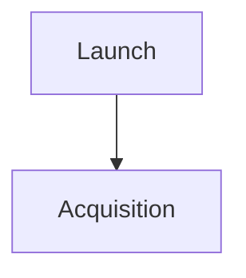

# Markdig Extension Reference

This document describes the Markdown features configured by WikiWikiWorld. It is verified against the application pipeline in `src/WikiWikiWorld.Web/Services/MarkdownPipelineFactory.cs`, the custom extensions in `src/WikiWikiWorld.Web/MarkDigExtensions`, and Markdig 0.42.0.

## Pipeline overview

WikiWikiWorld has two Markdown pipelines:

| Pipeline | Used for | Features |
| --- | --- | --- |
| Full article | Article revisions and article-derived metadata | CommonMark, all custom WikiWikiWorld extensions, and Markdig's advanced extensions except media links |
| Talk | Short talk posts | CommonMark, automatic links, extra emphasis, extended lists, pipe tables, and hard line breaks |

Raw HTML is disabled in both pipelines. An author-written `<script>`, `<iframe>`, or other HTML element is displayed as text rather than executed. The full article pipeline also removes Markdig's built-in media-link extension; use `{{YouTube ...}}` for videos.

Custom `{{...}}` directives are available only in the full article pipeline. Talk posts display them literally.

## Custom directive conventions

| Syntax | Meaning |
| --- | --- |
| `{{Name}}` | A marker with no parameters |
| `{{Name VALUE}}` | A directive with one positional value |
| `|#|` | Separates properties within one item |
| `|~|` | Separates repeating items in a container |
| `Key=Value` | Assigns a named property |
| `file:slug` | Refers to a file article; accepted only where documented |

Directive names are case-sensitive. Named properties are generally case-insensitive. Unless a directive explicitly supports Markdown in a value, treat its values as plain text. The delimiter strings `|#|`, `|~|`, and `}}` cannot be escaped inside directive values.

## Custom directive index

| Directive | Extension class | Kind | Purpose |
| --- | --- | --- | --- |
| `Subtitle` | `SubtitleExtension` | Block metadata | Subtitle beneath the article title |
| `ShortDescription` | `ShortDescriptionExtension` | Block metadata | SEO and summary description |
| `Eyebrow` | `EyebrowExtension` | Block metadata | Article-type label above the title |
| `Source` | `SourceExtension` | Block metadata | File or image provenance |
| `HeaderImage` | `HeaderImageExtension` | Block metadata | Article hero image |
| `Stub` | `StubExtension` | Block | Incomplete-article notice |
| `Image` | `ImageExtension` | Inline | Wiki-hosted image |
| `YouTube` | `YouTubeExtension` | Block | Controlled click-to-load YouTube video |
| `DownloadsBox` | `DownloadsBoxExtension` | Block | Download information and link |
| `PullQuote` | `PullQuoteExtension` | Inline | Display pull quote |
| `Footnote` / `Footnotes` | `FootnoteExtension` | Inline + block | Inline notes and collected note list |
| `Citation` / `Citations` | `CitationExtension` | Inline + block | Bibliographic references and bibliography |
| `Category` / `Categories` | `CategoryExtension` | Inline + block | Article categories and category link list |
| `PublicationIssueInfobox` | `PublicationIssueInfoboxExtension` | Container block | Publication issue cover and facts |
| `CoverGrid` | `CoverGridExtension` | Container block | Grid of publication issue covers |
| `CoverCarousel` | `CoverCarouselExtension` | Container block | Standalone cover carousel |
| `Timeline` | `TimelineExtension` | Container block | Chronological milestone list |
| `IssueCredits` | `IssueCreditsExtension` | Container block | Featured and collapsible contributor groups |

### Issue credits

`{{IssueCredits ...}}` groups contributor entries beneath author-defined titles. Group-header items use `Group=Title`, optional `Featured=true` (always visible), and optional `Open=true` (initially expanded). Other groups start closed. Separate items with `|~|` and properties with `|#|`. Each credit entry accepts an optional plain-text `Role=` and one or more `Name=` properties; names support inline Markdown and article links. Each group needs at least one entry. Group headers and credit entries are separate items.

See the [complete authoring guide](doc/issue-credits.md), [designer handoff](doc/issue-credits-designer-handoff.md), and [unstyled HTML fixture](doc/issue-credits-example.html). The local wiki guide is `/wiki:issue-credits`. Run `python scripts/publish_issue_credits_docs.py` to add it and a revisioned formatting-index link to an existing local database; existing credits documentation is preserved.

`ApprovedNoFollowLinksExtension` has no author directive. It post-processes links and is documented under [Link processing](#link-processing).

## Metadata directives

Metadata directives do not render their value in the article body. The article view reads the extracted metadata and places it elsewhere on the page. When several copies are present, the first matching directive is used unless noted otherwise.

### `Subtitle`

Sets the subtitle displayed beneath the article title.

```markdown
{{Subtitle The independent magazine that changed technology publishing}}
```

| Parameter | Required | Features |
| --- | --- | --- |
| Positional subtitle text | Yes | Plain text; leading and trailing whitespace is removed |

- Metadata key: `Subtitle`.
- The first `Subtitle` block is considered; if it is empty, subtitle metadata is not set.
- The directive must be on one line and include the space after `Subtitle`.

### `ShortDescription`

Sets the short description used for summaries and metadata.

```markdown
{{ShortDescription Wired Magazine, Issue #1, January 1993.}}
```

| Parameter | Required | Features |
| --- | --- | --- |
| Positional description | Yes | Plain text; leading and trailing whitespace is removed |

- Metadata key: `ShortDescription`.
- The first block is used.
- The directive must be on one line.

### `Eyebrow`

Selects a fixed article-type label displayed above the title.

```markdown
{{Eyebrow MAGAZINEISSUE}}
```

| Value | Displayed label |
| --- | --- |
| `MAGAZINE` | Magazine |
| `MAGAZINEISSUE` | Magazine Issue |
| `MAGAZINEFRANCHISE` | Magazine Franchise |

- Values are case-insensitive.
- Metadata key: `Eyebrow`.
- The first valid block is used.
- Only the three values above are supported. An unknown value is consumed rather than displayed as source text and must be corrected by the author.

### `Source`

Records the source or provenance of a file or image.

```markdown
{{Source Original print scan}}

{{Source https://example.com/archive/scan.jpg}}

{{Source Internet Archive scan |#| https://example.com/archive/scan.jpg}}
```

| Parameter | Required | Features |
| --- | --- | --- |
| Source text | Yes | Plain display text |
| Source URL | No | Separated from the text with `|#|` |

- A value beginning with `http://` or `https://` is treated as both the text and URL.
- In the two-part form, an empty text value falls back to the URL.
- Metadata keys: `SourceText` and, when present, `SourceUrl`.
- The first block is used.

### `HeaderImage`

Sets the article hero image by referring to a current file article in the same site and culture.

```markdown
{{HeaderImage wired-issue-1-cover}}

{{HeaderImage file:wired-issue-1-cover}}
```

| Parameter | Required | Features |
| --- | --- | --- |
| File article slug | Yes | Bare slug or `file:`-prefixed slug |

- The reference is slug-normalized before lookup.
- The referenced article must have a current canonical file revision.
- The first successfully resolved header image becomes the hero image.
- Metadata key: `HeaderImage`.
- An unresolved reference produces no hero image.

## Article content directives

### `Stub`

Renders an incomplete-article notice at the directive's location. It is normally the last item in an article.

```markdown
{{Stub}}
```

- Takes no parameters.
- Displays the current site name when available.
- Links to `/wiki:stub` and to the current article editor when enrichment supplied an edit URL.
- Multiple markers render multiple notices.

### `Image`

Renders an image from a current file article in the same site and culture.

```markdown
{{Image file:wired-1-spread |#| Layout=breakout |#| Alt=Two-page opening spread |#| Caption=The opening spread}}
```

| Parameter | Required | Allowed values or behavior |
| --- | --- | --- |
| File article slug | Yes | Bare slug or `file:`-prefixed slug |
| `Layout` | No | `full`, `breakout`, or `max`; any other value adds no layout class |
| `Alt` | No | Plain alternate text; falls back to the file article title |
| `Caption` | No | Parsed and stored, but currently not rendered |

- This is an inline directive and can appear within prose.
- Named properties are case-insensitive.
- Canonical examples should use `|#|` between properties. The current parser also accepts a bare `|` within the property tail.
- An unresolved article, missing canonical file, or missing file revision renders the site's `missing-image.png` fallback.

### `YouTube`

Renders a local, responsive click-to-load placeholder. No YouTube image, iframe, script, or network request is created before the reader activates it. Activation replaces the placeholder with a privacy-enhanced `youtube-nocookie.com` iframe.

```markdown
{{YouTube https://youtu.be/M7lc1UVf-VE |#| Title=YouTube player demonstration |#| StartSeconds=90 |#| Caption=Demonstration of the embedded player}}
```

| Parameter | Required | Allowed values or behavior |
| --- | --- | --- |
| Video reference | Yes | An 11-character video ID or an accepted YouTube URL |
| `Title` | Yes | Non-empty plain text used for the visible label and accessible player title |
| `StartSeconds` | No | Non-negative integer; overrides a URL timestamp |
| `Caption` | No | Plain text rendered in `<figcaption>` |

Accepted references:

- Bare IDs containing exactly 11 ASCII letters, digits, `_`, or `-`.
- `youtube.com/watch?v=VIDEO_ID`, including `www.youtube.com` and `m.youtube.com`.
- `youtu.be/VIDEO_ID`.
- `youtube.com/shorts/VIDEO_ID`.
- `youtube.com/embed/VIDEO_ID`.
- `youtube-nocookie.com/embed/VIDEO_ID`, with or without `www`.
- `http` and `https` are accepted, but only default ports and exact hosts are allowed.

URL query rules:

| URL form | Allowed query parameters |
| --- | --- |
| `watch` | `v`, `t`, `start`, `si`, `feature` |
| `youtu.be`, `shorts`, YouTube `embed` | `t`, `start`, `si`, `feature` |
| `youtube-nocookie.com/embed` | `t`, `start` |

- `t` accepts integer seconds or ordered `h`, `m`, and `s` components such as `1h2m30s`.
- `start` accepts integer seconds.
- A URL containing both `t` and `start` is rejected as ambiguous.
- Duplicate or unknown directive properties and URL parameters are rejected.
- User information, non-default ports, fragments, playlists, unsupported paths, and host-prefix tricks are rejected.
- An invalid directive remains visible as escaped text so the author can correct it.
- The no-JavaScript fallback opens the canonical YouTube watch page, including the selected timestamp.
- The iframe uses autoplay, fullscreen support, a constrained permissions policy, and `strict-origin-when-cross-origin` referrer policy.

### `DownloadsBox`

Looks up a download record by SHA-256 hash and renders its filename, human-readable file size, and download button.

```markdown
{{DownloadsBox 0123456789abcdef0123456789abcdef0123456789abcdef0123456789abcdef}}
```

| Parameter | Required | Features |
| --- | --- | --- |
| SHA-256 hash | Yes | Exact value used to look up `DownloadUrl.HashSha256` for the current site |

- The parser requires a non-empty value but does not independently enforce hexadecimal characters or a 64-character length.
- A missing database record renders “Download file not available.”
- A resolved record displays the filename and a base-1024 size from bytes through TB.
- The download opens in a new tab with `rel="noopener noreferrer"`.

### `PullQuote`

Renders a styled pull quote with optional attribution.

```markdown
{{PullQuote "We are at ground zero of a worldwide revolution." |#| Louis Rossetto}}
```

| Parameter | Required | Features |
| --- | --- | --- |
| Quote text | Yes | HTML-encoded text placed in the quote paragraph; `**bold**` words render in wide heavy caps for emphasis, `*italic*` renders as italic |
| Attribution | No | Text after `|#|` (or after a new line starting with `—`), rendered as a small-caps citation line; `*italic*` is supported for publication names |

- This is an inline directive and can appear within prose.
- Surrounding straight or curly double quotes on the quote text are stripped; curly quotes are added by the renderer.
- Emphasise a few key words or a short phrase, e.g. `{{PullQuote We didn’t wake up for less than **$10,000 a day**. |#| Linda Evangelista, *Vogue* — 1990}}`.
- One pair of surrounding straight double quotes is removed from the quote.
- Quote and attribution values are not parsed as nested Markdown.

## Collected reference directives

### `Footnote` and `Footnotes`

`Footnote` creates an inline reference. `Footnotes` renders the collected numbered list, normally near the end of the article.

```markdown
The archive closed in 2005.{{Footnote See *Archive Quarterly*, issue 18.}}

{{Footnotes}}
```

| Directive | Parameter | Required | Features |
| --- | --- | --- | --- |
| `Footnote` | Footnote body | Yes | Supports Markdown, links, and multiple Markdown blocks |
| `Footnotes` | None | — | Receives and renders all custom footnotes |

- Footnotes are numbered in document order starting at 1.
- Every `Footnote` occurrence gets its own number; custom footnotes are not de-duplicated.
- References and list items include forward and return links.
- The first `Footnotes` block receives the entries. Use exactly one.
- Without a `Footnotes` block, references still appear but no collected list is rendered.
- Nested raw HTML remains disabled.
- Markdig's separate `[^label]` footnote syntax is also available; see [Built-in footnotes](#built-in-footnotes).

### `Citation` and `Citations`

`Citation` creates an inline `†N` reference. `Citations` renders the collected bibliography.

```markdown
The publication began in 1993.{{Citation author=Smith, Jane |#| author=Doe, John |#| title=Founding Wired |#| journal=Media History |#| volume=4 |#| issue=2 |#| pages=10-18 |#| year=1993 |#| doi=10.1000/example |#| url=https://example.com/article}}

{{Citations}}
```

| Property | Repeatable | Rendered behavior |
| --- | --- | --- |
| `author` | Yes | All values are rendered in order with commas and “and” |
| `title` | Accepted repeatedly; first used | Italicized; becomes the link when `url` is present |
| `journal` | Accepted repeatedly; first used | Italicized publication name; takes precedence over `publisher` |
| `publisher` | Accepted repeatedly; first used | Used when `journal` is absent |
| `volume` | Accepted repeatedly; first used | Rendered as `vol.` |
| `issue` | Accepted repeatedly; first used | Rendered as `no.` only when `volume` is present |
| `pages` | Accepted repeatedly; first used | Rendered as `pp.` |
| `year` | Accepted repeatedly; first used | Rendered as the year |
| `doi` | Accepted repeatedly; first used | Linked through `https://doi.org/` |
| `url` | Accepted repeatedly; first used | Links the title, or displays the URL's host when no title exists |

- Property names are case-insensitive.
- Unknown properties are retained internally but are not rendered.
- Identical raw citation payloads are de-duplicated into one bibliography entry with multiple back-links. Property reordering or other textual changes create a different citation.
- Citations are numbered by the first occurrence of each unique payload.
- The first `Citations` block receives the bibliography. Use exactly one.
- Without a `Citations` block, inline references still appear but no bibliography is rendered.
- External citation and DOI links open in a new tab and receive the configured approved-domain `rel` policy.
- Markdig's `""cited text""` syntax is unrelated; it produces a semantic `<cite>` element rather than a bibliography entry.

### `Category` and `Categories`

`Category` records an article category without rendering at its inline location. `Categories` renders the collected category links.

```markdown
{{Category Technology Magazines}}
{{Category 1993 Publications}}

{{Categories}}
```

| Directive | Parameter | Required | Features |
| --- | --- | --- | --- |
| `Category` | Category title | Yes | Plain category name |
| `Categories` | None | — | Renders all non-empty category markers |

- Categories remain in document order. Repeated category markers currently produce repeated entries.
- Link slugs are generated by trimming the title, replacing spaces with `-`, and lowercasing it.
- Links use `/category:<slug>`.
- Every `Categories` block renders the complete collected list; normally use one.

## Container directives

Container directives may be written on one line, but the multi-line forms are easier to maintain.

### `PublicationIssueInfobox`

Renders an `<aside class="infobox">` containing zero or more cover images and a definition list of publication properties.

```markdown
{{PublicationIssueInfobox
CoverImage=file:wired-issue-1-cover |#|
CoverImage=file:wired-issue-1-back |#|
CoverDate=1993-01 |#|
CoverPrice=$4.95 |#|
PublicationFormats=Print |#|
PrintPublicationDate=1993-01-02 |#|
ElectronicPublicationDate=1993-01-02 |#|
PrintEAN-13=1234567890123 |#|
PrintEAN-2=01 |#|
ISSN=1059-1028
}}
```

| Property | Required | Features |
| --- | --- | --- |
| `CoverImage` | No | Repeatable file article slug; accepts `file:` prefix |
| Any other `Key=Value` | No | Repeatable fact rendered as a `<dt>`/`<dd>` pair |

Friendly display labels are defined for these canonical keys:

| Key | Label |
| --- | --- |
| `CoverPrice` | Cover Price |
| `PublicationFormats` | Publication Formats |
| `CoverDate` | Cover Date |
| `PrintPublicationDate` | Print Publication Date |
| `ElectronicPublicationDate` | Electronic Publication Date |
| `PrintEAN-13` | Print EAN-13 |
| `PrintEAN-2` | Print EAN-2 |
| `ISSN` | ISSN |

- Keys are collected case-insensitively, but use the canonical casing above to receive the friendly label.
- Unknown keys are displayed verbatim and are therefore supported as additional facts.
- Repeated non-image properties render as repeated definition rows.
- One resolved cover renders directly. Multiple covers render a scroll-snap carousel with previous/next buttons and position dots.
- An unresolved cover reference renders `missing-image.png`.
- Cover alt text comes from the referenced file article title, falling back to “Publication Cover”.

### `CoverGrid`

Renders a responsive linked grid of publication issue covers.

```markdown
{{CoverGrid
wired-issue-1
wired-issue-2
wired-issue-3
}}
```

| Parameter | Required | Features |
| --- | --- | --- |
| Publication issue article slug | At least one | One slug per non-empty line, in display order |

- Each issue article is expected to contain a `PublicationIssueInfobox` with a `CoverImage` property.
- The grid resolves the issue, its first cover-image slug, the cover article, and the current file revision.
- Each cover links to `/{culture}/{issue-slug}` and displays the issue title.
- Missing articles or covers use `cover-missing.png` when the block can otherwise be enriched.
- If no referenced issue exposes any cover slug, the grid renders nothing.

### `CoverCarousel`

Renders one or more wiki-hosted cover files without the publication facts shown by an infobox.

```markdown
{{CoverCarousel
CoverImage=file:wired-issue-1-cover |#| AltText=Front cover |#| Caption=Issue one
|~|
CoverImage=file:wired-issue-1-back |#| AltText=Back cover
}}
```

| Property | Required | Features |
| --- | --- | --- |
| `CoverImage` | Yes per item | File article slug; accepts `file:` prefix |
| `AltText` | No | Plain alt text; falls back to article title, then “Cover” |
| `Caption` | No | Parsed and stored, but currently not rendered |

- `|~|` starts the next cover item; `|#|` separates properties within that item.
- Property names are case-insensitive; unknown properties are ignored.
- An item without a non-empty `CoverImage` is skipped.
- If a property repeats within one item, the last recognized value wins.
- One resolved item renders a plain single-image aside without controls.
- Multiple items render a scroll-snap carousel with previous/next buttons and position dots.
- An unresolved cover renders `missing-image.png` instead of dropping the item.

### `Timeline`

Renders chronological milestones as an ordered vertical timeline.

```markdown
{{Timeline
Title=Launch |#| Date=1985 |#| Description=The magazine was launched by **Example Press**.
|~|
Title=Acquisition |#| Date=October 1998 |#| Description=The title was acquired by [Example Group](https://example.com).
}}
```

| Canonical property | Required | Aliases | Features |
| --- | --- | --- | --- |
| `Title` | Yes per item | `Heading`, `Header`, `Name` | Plain-text event heading |
| `Date` | No | `Time`, `Period`, `Year` | Plain-text date or timeframe |
| `Description` | No | `Body`, `Content`, `Text`, `Desc` | Markdown narrative |

- `|~|` starts the next milestone; `|#|` separates properties within that milestone.
- Property names and aliases are case-insensitive; unknown properties are ignored.
- A milestone without a non-empty title is skipped.
- If an equivalent property repeats, the last non-empty value wins.
- Titles and dates are HTML-encoded.
- Descriptions support automatic links, extra emphasis, and pipe tables. Raw HTML is disabled.

## Link processing

`ApprovedNoFollowLinksExtension` post-processes ordinary Markdown links and automatic links:

- Relative links are unchanged.
- Images are ignored.
- Every `http://`, `https://`, or protocol-relative external link receives `rel="noopener"`.
- External links whose host is not in `SiteConfiguration.ApprovedLinkDomains` receive `rel="nofollow noopener"`.
- Citation URLs apply the same approved-domain decision in their dedicated renderer.

## Built-in Markdig features in full articles

The full pipeline starts with CommonMark and calls Markdig 0.42.0 `UseAdvancedExtensions()`. The built-in `MediaLinkExtension` is then removed, leaving the features below.

### Alert blocks

GitHub-style alert types are `NOTE`, `TIP`, `IMPORTANT`, `WARNING`, and `CAUTION`. The alert marker must be the first content in a block quote and be followed by a new line.

```markdown
> [!NOTE]
> This issue used two different cover treatments.
```

### Abbreviations

An abbreviation definition is removed from the rendered location. Whole matching labels elsewhere become `<abbr>` elements. Labels may contain spaces and Unicode.

```markdown
*[ISSN]: International Standard Serial Number

The ISSN identifies the serial publication.
```

### Heading auto-identifiers

Headings receive generated IDs. Duplicate IDs gain `-1`, `-2`, and so on. A heading can be referenced by its exact text.

```markdown
## Publication history

[Return to publication history][Publication history]
```

### Built-in citations

Double straight quotation marks create a semantic `<cite>` inline. This is separate from WikiWikiWorld's `{{Citation ...}}` bibliography.

```markdown
This account first appeared in ""Magazine Histories"".
```

### Custom containers

Three or more colons create a `<div>`. Text following the opening colons becomes its class. Matching longer fences are supported, as are nested Markdown blocks and generic attributes.

```markdown
:::sidebar {#collectors-note data-kind=archive}
This content renders inside a `sidebar` container.
:::
```

Two colons create an inline `<span>` container:

```markdown
This is ::specially styled::{.highlight} text.
```

### Definition lists

One or more terms may have one or more definitions. A definition begins with `:` and enough following indentation to reach four columns.

```markdown
Frequency
:   Monthly

Publisher
:   Example Press
```

Definitions can contain paragraphs, lists, quotes, and code blocks when indented beneath the definition.

### Extra emphasis

| Syntax | Result |
| --- | --- |
| `~~deleted~~` | Strikethrough (`<del>`) |
| `~2~` | Subscript (`<sub>`) |
| `^10^` | Superscript (`<sup>`) |
| `++inserted++` | Inserted text (`<ins>`) |
| `==marked==` | Highlighted text (`<mark>`) |

```markdown
The ~~weekly~~ ==monthly== title contains H~2~O in issue 2^10^.
```

### Figures

Three or more carets create a figure fence. Text following the closing fence is parsed as the caption.

```markdown
^^^

^^^ Original launch cover
```

### Footers

Lines beginning with `^^` form a footer block.

```markdown
^^ Research compiled from the publisher archive.
^^ Last checked in 2026.
```

### Built-in footnotes

Markdig's labeled footnotes work independently of `{{Footnote ...}}` and do not require a `{{Footnotes}}` marker.

```markdown
This statement has a footnote.[^archive]

[^archive]: Publisher archive, box 12.
```

- A label may be referenced more than once.
- Definitions may contain multiple indented Markdown blocks.
- Markdig automatically appends the collected built-in footnote list.

### Grid tables

Grid tables support multi-line cells, column spans, headers, and alignment.

```markdown
+------------+----------+
| Field      | Value    |
+============+==========+
| Frequency  | Monthly  |
+------------+----------+
| Notes span both cells |
+------------+----------+
```

- The first separator establishes column boundaries.
- `=` separators create the header boundary.
- Colons on separator segments control left, center, or right alignment.
- Omitting an internal `|` allows a cell to span columns.

### Mathematics

Inline mathematics uses one or two dollar signs. A display block uses `$$` fences on their own lines.

```markdown
The ratio is $x / y$.

$$
x = \frac{a + b}{2}
$$
```

Markdig emits MathJax-compatible wrappers. The application currently does not load a MathJax or KaTeX client library, so this extension provides markup hooks rather than guaranteed typesetting.

### Pipe tables

Pipe tables support a header row, body rows, inline Markdown, and per-column alignment.

```markdown
| Issue | Month | Price |
| :--- | :---: | ---: |
| 1 | January | $4.95 |
| 2 | February | $4.95 |
```

- A colon on the left aligns left, on both sides centers, and on the right aligns right.
- Starting and ending pipes are optional.
- Every table source row must contain a pipe.

### Extended lists

In addition to CommonMark numeric lists, ordered lists may use lowercase or uppercase alphabetic and Roman-numeral markers. Restarted lists preserve their starting value.

```markdown
a. First appendix
b. Second appendix

iv. Fourth item
v. Fifth item
```

### Task lists

`[ ]`, `[x]`, or `[X]` at the start of an ordered or unordered list item produces a disabled checkbox.

```markdown
- [x] Cover scanned
- [ ] Contents indexed
```

### Diagrams

Fenced code blocks labeled `mermaid` or `nomnoml` emit diagram-specific containers.

````markdown

````

````markdown
```nomnoml
[Publisher]->[Magazine]
```
````

The application currently does not load Mermaid or nomnoml client libraries, so these extensions provide markup hooks rather than guaranteed rendered diagrams.

### Automatic links

Plain text beginning with `http://`, `https://`, `ftp://`, `mailto:`, `tel:`, or `www.` is linked automatically when it appears at a valid word boundary.

```markdown
Visit https://example.com or email mailto:archive@example.com.
```

The full article link post-processor then applies the approved-domain `rel` policy.

### Generic attributes

Attributes can attach to a preceding inline element, the current block, or the next block when placed alone on the preceding line.

| Attribute syntax | Result |
| --- | --- |
| `#identifier` | `id="identifier"` |
| `.class-name` | Adds a CSS class |
| `name=value` | Adds an attribute |
| `name="value with spaces"` | Adds a quoted attribute value |
| `boolean-name` | Adds an empty-valued attribute |

````markdown
## Archive holdings {#holdings .catalog-section}

[Publisher archive](https://example.com){.external data-kind=primary-source}

{#scan-code .wide}
```text
Box 12, folder 4
```
````

Generic attributes are the last built-in parser registered so they can decorate output from other compatible Markdig extensions.

## Talk-post Markdown

Talk posts deliberately omit every custom `{{...}}` directive and most advanced article extensions. They support:

- CommonMark paragraphs, headings, emphasis, strong emphasis, block quotes, code, links, images, and ordered/unordered lists.
- Automatic links for `http://`, `https://`, `ftp://`, `mailto:`, `tel:`, and `www.` text.
- Extra emphasis: strikethrough, subscript, superscript, inserted text, and marked text.
- Alphabetic and Roman-numeral ordered lists.
- Pipe tables.
- Soft line breaks rendered as `<br />` for chat-style formatting.
- Raw HTML displayed as text.

```markdown
This line
breaks here in a talk post.

- [This custom directive remains text: {{Stub}}](https://example.com)
```

Task lists, custom directives, automatic heading IDs, generic attributes, diagrams, mathematics, grid tables, alerts, and the other full-article-only features are not enabled in talk posts.

## Deliberately unavailable authoring paths

- Raw HTML is disabled in articles and talk posts.
- Markdig's media-link syntax is disabled. An image-style YouTube link such as `` remains an ordinary image rather than producing an iframe.
- Emoji, SmartyPants typography, Bootstrap classes, and the advanced pipeline's soft-line-as-hard-line-break option are not enabled for articles.
- YouTube playlists, channel embeds, and arbitrary iframe providers are not supported by the custom YouTube directive.
